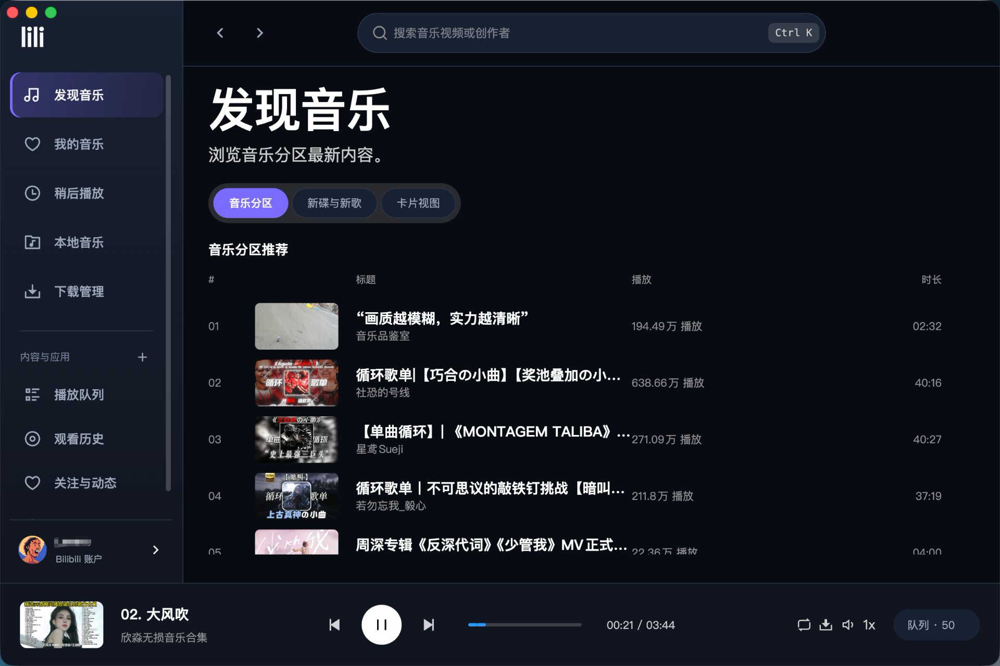

<h1 align="center">lili 音乐播放器</h1>
<p align="center">
  
</p>
<p align="center">
  基于哔哩哔哩（B 站）公开接口的跨平台桌面音乐播放器 🎧🎶
</p>
<p align="center">
  非官方项目，与哔哩哔哩无任何官方关联或背书
</p>
<p align="center">
  <a href="https://github.com/Leeero/LiLi/releases">
    
  </a>
  <a href="LICENSE"></a>
</p>

<p align="center">
  
</p>

---

> **关于这个仓库**：lili 是基于 [wood3n/biu](https://github.com/wood3n/biu) 二次开发的非官方版本，
> 保留了上游完整提交记录。许可证沿用上游的 PolyForm Noncommercial 1.0.0，**仅限非商业用途**。
> 详细的归属与署名要求见 [许可证与上游归属](#-许可证与上游归属) 与 [`NOTICE`](NOTICE)。

## ✨ 特色功能

- 🎼 以音乐播放为核心，支持发现音乐、播放队列、收藏夹、稍后播放和历史记录
- 📚 统一音乐库集中呈现用户创建和收藏的歌单，保留原有 Bilibili 账户数据能力
- 💿 支持扫描和播放本地音乐，本地内容与在线内容可进入同一个播放队列
- 🎧 优先获取可用的高品质音频流，包括无损 Flac、192K 和 Hi-Res
- 🔥 支持下载视频或提取音频，并提供收藏夹内容批量下载和任务管理
- 👥 支持关注的创作者、最新动态和创作者内容浏览，社交能力收纳在音乐主流程之外
- 🧩 提供浅色、深色主题，以及字体、主色、圆角和播放器显示选项
- 🍃 支持全屏播放器、歌词、频谱、播放列表抽屉与 mini 播放器
- 💿 支持系统托盘、最小化隐藏、全局快捷键和自动更新

## 下载和使用

- 下载页面：[GitHub Releases](https://github.com/Leeero/LiLi/releases/latest)
- 快速选择：
  -  优先选安装包 `win-setup`；需要免安装/无管理员权限选 `win-portable`
  -  优先选 `dmg`；需要脚本/自动化分发可选 `zip`
  -  优先选 `AppImage`；偏好包管理器可选 `deb`/`rpm`
- 常见产物对比如下（`<version>` 为版本号，`<arch>` 常见为 `x64`/`arm64`）：

<table>
  <thead>
    <tr>
      <th align="left">系统</th>
      <th align="left">推荐下载</th>
      <th align="left">优点</th>
      <th align="left">限制</th>
      <th align="left">文件名示例</th>
    </tr>
  </thead>
  <tbody>
    <tr>
      <td>
        
        <br />
        <code>x64</code>/<code>arm64</code>
      </td>
      <td>
        安装包（NSIS）
        <br />
        <code>win-setup</code>
      </td>
      <td>
        一键安装/卸载、开始菜单/桌面快捷方式<br />
        通常兼容性最好、适合长期使用<br />
        自动更新支持更完整
      </td>
      <td>
        需要安装到磁盘（非免安装）<br />
        可能触发系统权限/安全提示
      </td>
      <td>
        <code>lili-&lt;version&gt;-win-setup-x64.exe</code><br />
        <code>lili-&lt;version&gt;-win-setup-arm64.exe</code>
      </td>
    </tr>
    <tr>
      <td>
        
        <br />
        <code>x64</code>/<code>arm64</code>
      </td>
      <td>
        免安装版（Portable）
        <br />
        <code>win-portable</code>
      </td>
      <td>
        解压/下载即用，不改系统配置<br />
        适合U盘/临时环境/无管理员权限
      </td>
      <td>
        应用内自动更新受限，通常需要手动下载替换
      </td>
      <td>
        <code>lili-&lt;version&gt;-win-portable-x64.exe</code><br />
        <code>lili-&lt;version&gt;-win-portable-arm64.exe</code>
      </td>
    </tr>
    <tr>
      <td>
        
        <br />
        <code>x64</code>/<code>arm64</code>
      </td>
      <td>
        DMG（推荐）
        <br />
        <code>.dmg</code>
      </td>
      <td>
        拖拽安装体验好、适合大多数用户<br />
        分发与回收方便
      </td>
      <td>
        首次打开可能需要在系统设置中允许来源<br />
        不同系统安全策略提示不同
      </td>
      <td>
        <code>lili-&lt;version&gt;-mac-x64.dmg</code><br />
        <code>lili-&lt;version&gt;-mac-arm64.dmg</code>
      </td>
    </tr>
    <tr>
      <td>
        
        <br />
        <code>x64</code>/<code>arm64</code>
      </td>
      <td>
        ZIP
        <br />
        <code>.zip</code>
      </td>
      <td>
        体积通常更小、适合脚本/CI 分发<br />
        解压即用
      </td>
      <td>
        安装体验不如 DMG 直观（需要手动放入应用目录）
      </td>
      <td>
        <code>lili-&lt;version&gt;-mac-x64.zip</code><br />
        <code>lili-&lt;version&gt;-mac-arm64.zip</code>
      </td>
    </tr>
    <tr>
      <td>
        
      </td>
      <td>
        AppImage（最通用）
        <br />
        <code>.AppImage</code>
      </td>
      <td>
        发行版通用、下载即运行<br />
        不依赖包管理器，适合多发行版
      </td>
      <td>
        需手动赋予可执行权限（例如 <code>chmod +x</code>）<br />
        桌面集成需要额外操作
      </td>
      <td>
        <code>lili-&lt;version&gt;-linux-x64.AppImage</code><br />
        <code>lili-&lt;version&gt;-linux-arm64.AppImage</code>
      </td>
    </tr>
    <tr>
      <td>
        
      </td>
      <td>
        DEB / RPM
        <br />
        <code>.deb</code> / <code>.rpm</code>
      </td>
      <td>
        更符合系统习惯，桌面/菜单集成更好<br />
        方便用系统包管理器安装/卸载
      </td>
      <td>
        与发行版/依赖关系更强（Debian/Ubuntu 用 <code>.deb</code>，Fedora/RHEL 用 <code>.rpm</code>）
      </td>
      <td>
        <code>lili-&lt;version&gt;-linux-x64.deb</code> / <code>.rpm</code><br />
        <code>lili-&lt;version&gt;-linux-arm64.deb</code> / <code>.rpm</code>
      </td>
    </tr>
    <tr>
      <td>
        
      </td>
      <td>
        AUR —— 属<b>上游 Biu</b>，不适用于 lili
        <br />
        <a href="https://aur.archlinux.org/packages/biu-bin"><code>biu-bin</code></a>
      </td>
      <td>
        由上游社区成员 <a href="https://github.com/cjlworld">@cjlworld</a> 维护
      </td>
      <td>
        <code>biu-bin</code> 打包的是上游 Biu 而非本仓库，安装后得到的是上游版本
      </td>
      <td>
        lili 暂无 AUR 包
      </td>
    </tr>
  </tbody>
</table>

- 系统要求（建议）
  -  Windows 10 / 11（`x64` / `arm64`）
  -  macOS 12+（`x64` / `arm64`）
  -  主流 Linux 发行版（`x64` / `arm64`）
- 架构怎么选
  - Windows：设置 → 系统 → 关于 → “系统类型”（ARM 设备选 `arm64`，其余多为 `x64`）
  - macOS：Apple 芯片选 `arm64`，Intel 芯片选 `x64`
  - Linux：执行 `uname -m`，常见 `x86_64` 对应 `x64`，`aarch64` 对应 `arm64`
- 自动更新说明
  - 应用会定期检查 GitHub Releases，下载安装更新（多数安装方式均支持）。
  - Windows 免安装版（portable）在应用内下载更新受限，建议前往 Releases 手动下载替换。
- `*.yml`、`*.blockmap` 为自动更新辅助文件，手动下载时无需关注。
- 使用注意
  - 部分音频清晰度与解析可能需要登录或大会员权限。
  - 请遵循 Bilibili 使用条款，合理合规使用。

### ⚠️ 从上游 Biu 迁移

lili 换了打包身份（`appId` 由 `com.biu.wood3n` 改为 `com.leeero.lili`），因此**与上游版本不是同一个应用**：

- 已安装的上游 Biu **不会自动升级**到 lili，需要手动下载安装。
- 二者可以并存，但用户数据目录相互独立（lili 使用自己的 `lili` 目录）。
- 需要沿用上游的登录态、收藏与下载记录时，可手动把旧数据目录复制到新目录。旧目录位置：

  | 平台 | 上游 Biu 的数据目录 |
  |---|---|
  | Windows | `%APPDATA%\Biu` |
  | macOS | `~/Library/Application Support/Biu` |
  | Linux | `~/.config/Biu` |

  新目录把其中的 `Biu` 换成 `lili` 即可。

## 📄 许可证与上游归属

- lili 是基于 [wood3n/biu](https://github.com/wood3n/biu) 二次开发的**非官方版本**，不是哔哩哔哩官方项目。
- 本项目以 **PolyForm Noncommercial License 1.0.0**（非商业许可）发布，禁止任何商业用途。详情参见 [`LICENSE`](LICENSE)（SPDX：`PolyForm-Noncommercial-1.0.0`）。
- 按上游许可证的 Notices 条款，任何分发副本都必须随附许可证原文，并完整保留下面这行署名：

  ```
  Required Notice: Copyright (c) 2022–2025 wood3n
  ```

  该行在本仓库的 [`LICENSE`](LICENSE) 与 [`NOTICE`](NOTICE) 中均逐字保留，应用内「设置 → 高级与关于 → 关于 lili」也可见。
- 上游代码的著作权归 wood3n 所有；本仓库未做历史重写，上游提交记录完整保留，用作归属证据链。
- 改名、换图标、更换打包身份都不改变上述署名与许可要求。

---

如果你喜欢这个项目，欢迎 ⭐️ Star 支持！也欢迎提出 Issue 交流与反馈 🙌

## 🙏 鸣谢

- 感谢 [@wood3n](https://github.com/wood3n) 创作的 [Biu 音乐播放器](https://github.com/wood3n/biu)——lili 的全部基础能力来自这个项目。
- 特别感谢 [SocialSisterYi/bilibili-API-collect](https://github.com/SocialSisterYi/bilibili-API-collect) 对哔哩哔哩 API 的长期收集与整理，为本项目相关接口的使用提供了重要参考。
- 感谢 [@cjlworld](https://github.com/cjlworld) 为 Arch Linux 用户创建并维护了 [上游 Biu 的 AUR 软件包](https://aur.archlinux.org/packages/biu-bin)。
- 在引用与使用相关资料时，我们遵循其许可条款（`CC-BY-NC 4.0`），仅用于学习与研究，不涉及任何商业用途。

## ⚖️ 法律声明与使用限制

- 本项目仅供学习与研究使用，禁止任何形式的商业用途（包括但不限于销售、收费服务、广告变现、商业集成等）。
- 本项目与 Bilibili 无任何官方关联或背书，不使用其商标与标识；涉及的名称与商标归其权利人所有。
- 数据来源于用户调用的公开接口与个人账户授权；使用时需遵守 Bilibili 的《用户协议》《社区规则》及相关法律法规。
- 禁止绕过登录/会员权限、DRM/加密措施，或进行批量爬取、恶意抓取等违反平台规则的行为。
- 如需商业授权或调整许可，请联系著作权人；如涉及权利或合规问题，请通过 Issues 反馈以便及时处理。

---

## 🤝 贡献指南

非常欢迎社区贡献！你可以按以下流程参与：

1. Fork 本仓库并创建分支：`feature/your-feature` / `fix/your-fix`
2. 开发并通过本地构建与基本自测（如：`pnpm dev`、`pnpm build`）
3. 提交 PR，详述改动点与影响范围
4. 通过 CI 的构建与审查后合入主分支

建议：

- 使用 ESLint/Prettier 保持代码风格一致（ESLint/Prettier 已配置）
- 提交信息简洁规范（推荐使用 `feat: ...`、`fix: ...` 等约定式格式）
- PR 中附上必要的截图或说明

> 改进上游基础能力的改动，建议同时向上游 [wood3n/biu](https://github.com/wood3n/biu) 提 PR，让两边都受益。

## ♥️ Contributors

<a href="https://github.com/Leeero/LiLi/graphs/contributors">
  
</a>

## 🌟 Star History

[](https://www.star-history.com/#Leeero/LiLi&type=date&legend=top-left)
